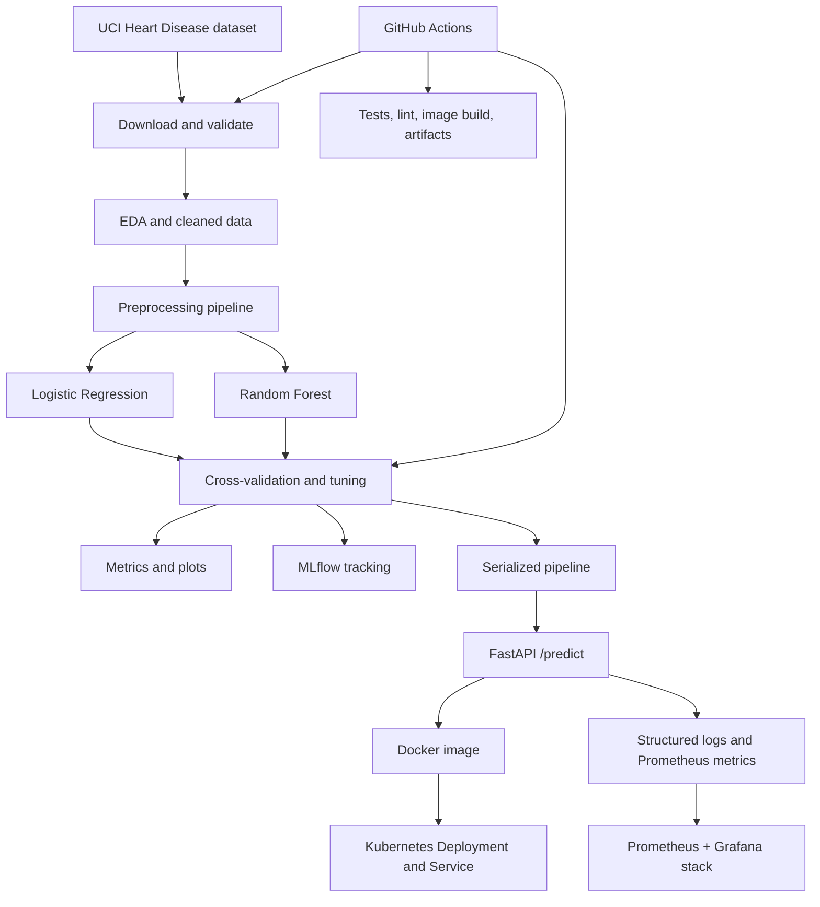

# End-to-End MLOps: Heart Disease Classification

**Student:** Vishnu Gopisetti | **ID:** 2025AE05666
**Course:** AIMLCZG523 — Machine Learning Operations (MLOps)
**Assignment:** 01 — End-to-End ML Model Development, CI/CD, and Production Deployment (50 marks)

> **Start here:** follow [`START_HERE.md`](START_HERE.md) for a time-boxed runbook and [`STATUS.md`](STATUS.md) for the honest requirements-to-evidence checklist. After a genuine local run, use `python scripts/generate_report.py` to generate `report_generated.pdf` from actual artifacts and any screenshots present.

> **Important health disclaimer:** This is an educational machine-learning demonstration using a small historical dataset. It is not a medical device and must not be used for diagnosis, treatment, triage, or other clinical decisions.

## 1. Project overview

This repository implements a reproducible binary classification workflow using the processed Cleveland subset of the UCI Heart Disease dataset. It includes data acquisition, EDA, leakage-safe preprocessing, two model families, cross-validation and grid search, MLflow experiment tracking (SQLite backend), model serialization, 40 automated tests, GitHub Actions, a FastAPI prediction service, Docker, Kubernetes manifests, logging, Prometheus metrics, and a provisioned Grafana dashboard.

Dataset source: UCI Machine Learning Repository, Heart Disease, DOI [10.24432/C52P4X](https://doi.org/10.24432/C52P4X). The Cleveland processed file has 303 records and 13 predictor attributes; the original `num` target ranges from 0 to 4. This project maps `num == 0` to class 0 and `num > 0` to class 1. See [`data/README.md`](data/README.md) for the full schema.

## 2. Architecture



## 3. Project structure

```text
mlops-heart-disease/
├── src/heart_disease/        # package: config, data, preprocessing, train,
│                             # evaluate, predict, api, monitoring
├── scripts/                  # CLI entry points: download_data, run_pipeline,
│                             # generate_report, validate_deployment, package_project
├── tests/                    # 40 pytest cases
├── notebooks/eda.ipynb       # executable EDA notebook (+ README)
├── data/                     # raw UCI file, processed/cleaned CSV (+ README)
├── models/                   # serialized joblib pipeline
├── reports/                  # figures/, artifacts/, report drafts
├── mlruns/ + mlflow.db       # MLflow artifacts + SQLite tracking store
├── monitoring/               # prometheus.yml, alert_rules.yml, grafana/
│                             # provisioning + provisioned dashboard (+ README)
├── deployment/
│   ├── kubernetes/           # namespace, deployment, service, configmap
│   └── cloud/                # GKE/EKS/AKS adaptation guide
├── demo/                     # recording_guide.md for the demo video
├── screenshots/              # evidence captured from real runs
├── Dockerfile, docker-compose.yml
├── Makefile, pyproject.toml, pytest.ini, requirements.txt
├── .github/workflows/        # CI/CD pipeline
└── START_HERE.md, STATUS.md, LICENSE
```

## 4. Environment setup

Python 3.11 is recommended. Run commands from the repository root.

```bash
python -m venv .venv
# Windows PowerShell:
.venv\Scripts\Activate.ps1
# macOS/Linux:
source .venv/bin/activate

make setup          # or: python -m pip install -r requirements.txt
```

The first data download requires internet access to UCI:

```bash
python scripts/download_data.py     # or: make data
```

The downloaded dataset is committed locally under `data/raw/` as a convenience copy; the UCI archive remains the source of truth.

## 5. Execute the complete workflow

One command end-to-end:

```bash
python scripts/run_pipeline.py      # download -> validate -> EDA -> train -> evaluate
```

Or step by step:

```bash
python scripts/download_data.py     # fetch + schema-check the UCI data
make eda                            # EDA figures + eda_summary.json (notebooks/eda.ipynb for the narrated version)
python -m src.heart_disease.train   # train, tune, log to MLflow, serialize the model
make test                           # pytest (40 tests)
make lint                           # ruff check src tests scripts
python scripts/generate_report.py   # report_generated.pdf from real artifacts + screenshots
```

Make targets available: `setup data eda train test lint report api docker-build docker-run deploy validate package clean`.

Outputs are written to:
- `data/processed/heart_disease_cleaned.csv`
- `reports/figures/` — distributions, class balance, correlation heatmap, confusion matrix, ROC curve
- `reports/artifacts/` — EDA summary, model comparison, selected model card, test metrics
- `models/heart_disease_pipeline.joblib`
- `mlflow.db` (SQLite tracking store) + `mlruns/` (run artifacts) — see [`mlruns/README.md`](mlruns/README.md)

Open MLflow's local UI in a separate terminal (this project uses the SQLite backend; add `--port 5001` if macOS AirPlay holds port 5000):

```bash
.venv/bin/mlflow ui --backend-store-uri sqlite:///mlflow.db --default-artifact-root ./mlruns
```

Then visit `http://127.0.0.1:5000` (or `:5001`).

## 6. API

Train the model first. Start the API:

```bash
uvicorn src.heart_disease.api:app --host 0.0.0.0 --port 8000    # or: make api (127.0.0.1)
```

Useful endpoints:
- `GET /` — service links
- `GET /health` — liveness/model-file check
- `GET /docs` — interactive OpenAPI docs
- `GET /metrics` — Prometheus metrics
- `POST /predict` — validated JSON input, binary prediction, probability, and confidence

Example:

```bash
curl -X POST http://127.0.0.1:8000/predict \
  -H "Content-Type: application/json" \
  -d '{
    "age": 55, "sex": 1, "cp": 2, "trestbps": 130, "chol": 240,
    "fbs": 0, "restecg": 1, "thalach": 150, "exang": 0,
    "oldpeak": 1.2, "slope": 2, "ca": 0, "thal": 3
  }'
```

A successful response looks like:

```json
{"prediction": 0, "label": "heart_disease_not_indicated", "confidence": 0.672567,
 "probability_heart_disease": 0.327433,
 "disclaimer": "Educational output only; not a medical diagnosis."}
```

The example is for API smoke testing only; its output is not a medical interpretation. Note: if another local service already binds port 8000 on your machine, start uvicorn with `--port 8001` and adjust the URLs.

## 7. Docker

```bash
make docker-build      # docker build -t heart-disease-api:latest .
make docker-run        # docker run --rm -p 8000:8000 heart-disease-api:latest
curl http://localhost:8000/health
```

Or use `docker compose up --build`. The image expects a trained model at `models/heart_disease_pipeline.joblib`.

## 8. Kubernetes (local Minikube)

Follow `deployment/kubernetes/` and `deployment/cloud/README.md`. Build and load the image into Minikube, apply the manifests, wait for rollout, and test `/health`, `/docs`, and `/predict`:

```bash
make docker-build
minikube start
minikube image load heart-disease-api:latest
kubectl apply -f deployment/kubernetes/
kubectl rollout status deployment/heart-disease-api -n heart-disease
kubectl get pods,svc -n heart-disease
minikube service heart-disease-api -n heart-disease --url
```

For local clusters, use `minikube service` or port-forwarding if a LoadBalancer external IP is not assigned. For GKE/EKS/AKS, see `deployment/cloud/README.md` for the registry push, image-field change, and ingress options.

## 9. CI/CD

`.github/workflows/` runs on pushes, pull requests, and manual dispatch. It installs dependencies, runs Ruff linting, downloads and validates the dataset, runs unit tests, generates EDA outputs, trains/logs both model candidates, builds a Docker image, and uploads outputs as workflow artifacts. A failure in linting, tests, data validation, training, or image build fails the job.

## 10. Modelling methodology

- Split: stratified 80/20 train/test split with fixed seed.
- Cross-validation: 5-fold stratified cross-validation on the training partition.
- Models: Logistic Regression and Random Forest.
- Tuning: grid search using mean CV ROC-AUC as the selection metric.
- Metrics: accuracy, precision, recall, F1, ROC-AUC, plus CV ROC-AUC mean and standard deviation.
- Preprocessing: median imputation and standard scaling for numeric features; most-frequent imputation and one-hot encoding for categorical features.
- Leakage control: preprocessing is inside each estimator pipeline, so each CV fold fits transformations only on its training fold.

The final model is selected by held-out ROC-AUC among the tuned candidates. For a strictly unbiased final estimate, model selection should occur on validation data and a separate untouched test set should be used only once after selection; this compact assignment implementation reports the selection procedure explicitly.

## 11. Experiment tracking

Each model run records model family, split seed, test fraction, fold count, CV means/standard deviations, selected grid parameters, test metrics, serialized MLflow model, and classification report. `comparison.json` and `model_card.json` provide machine-readable summaries. The tracking store is `mlflow.db` (SQLite) with artifacts under `mlruns/`; see [`mlruns/README.md`](mlruns/README.md) for UI launch commands and notes.

## 12. Monitoring and operations

The API logs request outcome, prediction class, duration, and client address to standard output. It exposes Prometheus metrics at `/metrics`: `prediction_requests_total` (counter, `status` label) and `prediction_request_duration_seconds` (histogram).

`monitoring/` ships a complete local stack wired by `docker-compose.yml`: Prometheus (scrapes the API every 15s), alerting rules (`APIDown`, `HighPredictionErrorRate`, `HighLatencyP95`, `NoTraffic`), and Grafana with an auto-provisioned "Heart Disease API" dashboard (request rate by status, p50/p95 latency, total requests, API up, error rate):

```bash
docker compose up -d prometheus grafana
# Prometheus UI: http://localhost:9090 (check Status > Targets)
# Grafana:       http://localhost:3000 (admin/admin; dashboard is pre-provisioned)
```

See [`monitoring/README.md`](monitoring/README.md) for standalone `docker run` equivalents and verification steps. In a real deployment, restrict log access, avoid logging patient features or identifiable health information, add authentication/TLS/rate limits, and define retention policies.

## 13. Reproducibility and known limitations

- Fixed random seeds are used for splitting, cross-validation, and model initialization.
- The preprocessing transformer and classifier are serialized together.
- Dependency ranges are specified in `requirements.txt`; for stronger long-term reproducibility, freeze exact resolved versions after a successful run.
- UCI source data may be unavailable when offline. Download once and retain the source file in a controlled local environment.
- Small, historical Cleveland data does not establish generalization to current clinical populations.
- API validation ranges are input-sanity checks, not clinical ranges or safety guarantees.
- Confidence is the model probability for the predicted class; it is not a calibrated clinical risk estimate.

## 14. Submission checklist

Current honest status for every item: [`STATUS.md`](STATUS.md).

- [ ] Run all workflow commands from a clean environment.
- [ ] Confirm EDA images and summary files exist.
- [ ] Inspect the model runs in MLflow and save a genuine screenshot.
- [ ] Confirm `pytest`, Ruff, and Docker build pass.
- [ ] Run the API and save real `/health`, `/predict`, and `/metrics` evidence.
- [ ] Deploy to Kubernetes and save `kubectl get pods,svc` plus endpoint evidence.
- [ ] Record a short screen video showing EDA → MLflow → tests/CI → Docker/API → monitoring → deployment (guide: `demo/recording_guide.md`).
- [ ] Push the repository to your own GitHub account and replace the repository URL in the final report.
- [ ] Review the report and be prepared to explain every major decision.

## References

1. Janosi, A., Steinbrunn, W., Pfisterer, M., & Detrano, R. (1989). *Heart Disease*. UCI Machine Learning Repository. https://doi.org/10.24432/C52P4X
2. Scikit-learn documentation: https://scikit-learn.org/
3. MLflow documentation: https://mlflow.org/docs/latest/
4. FastAPI documentation: https://fastapi.tiangolo.com/
5. Docker documentation: https://docs.docker.com/
6. Kubernetes documentation: https://kubernetes.io/docs/

## License

MIT — see [`LICENSE`](LICENSE).
