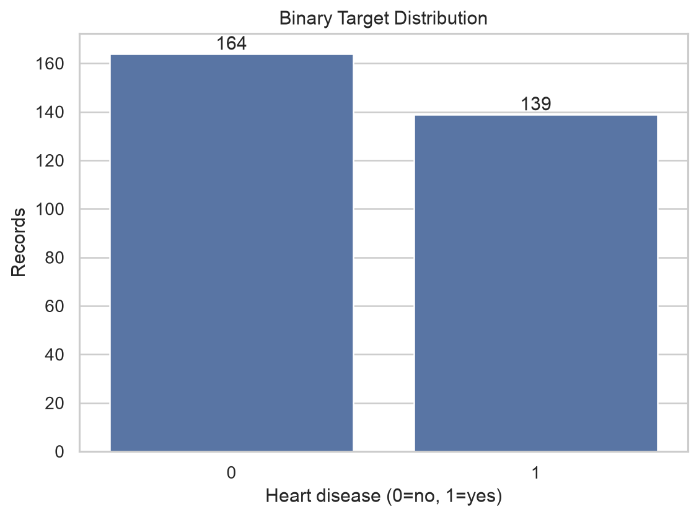
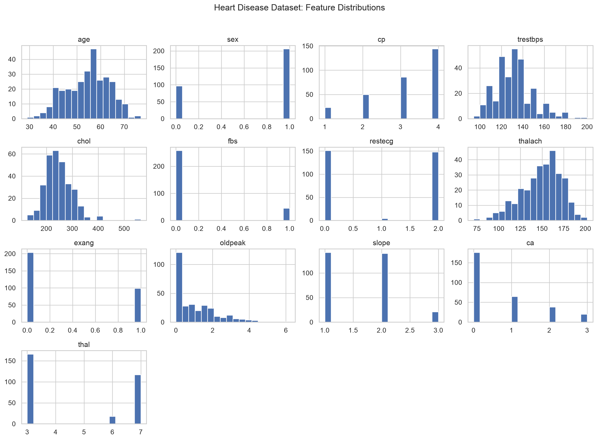
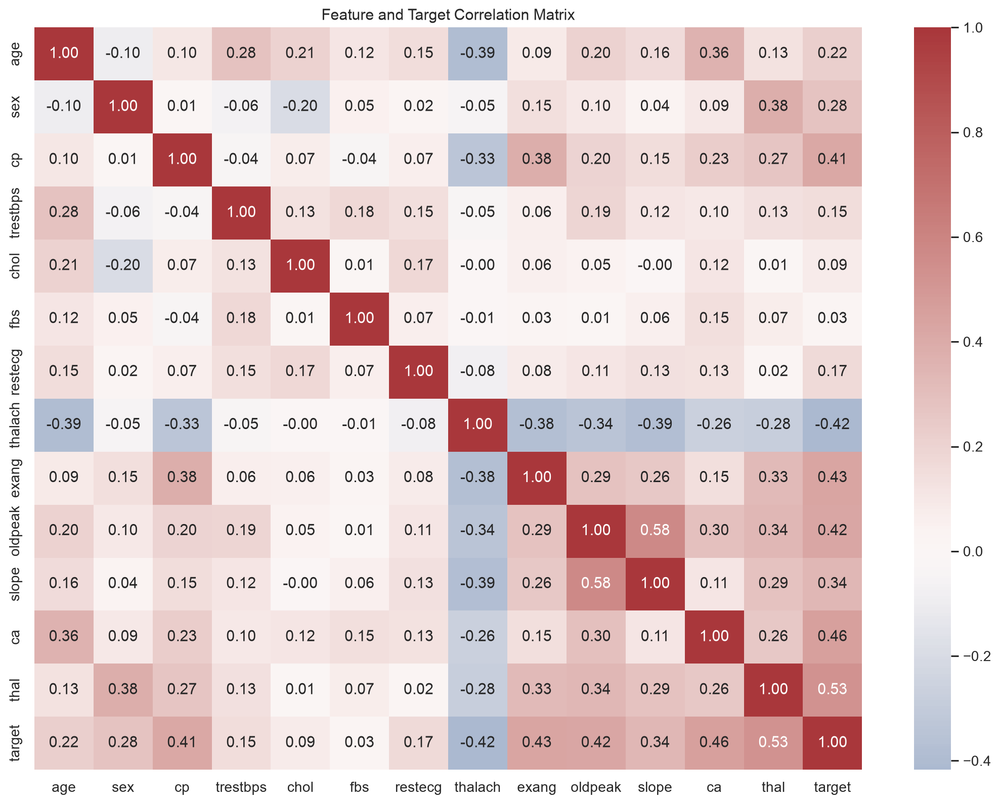
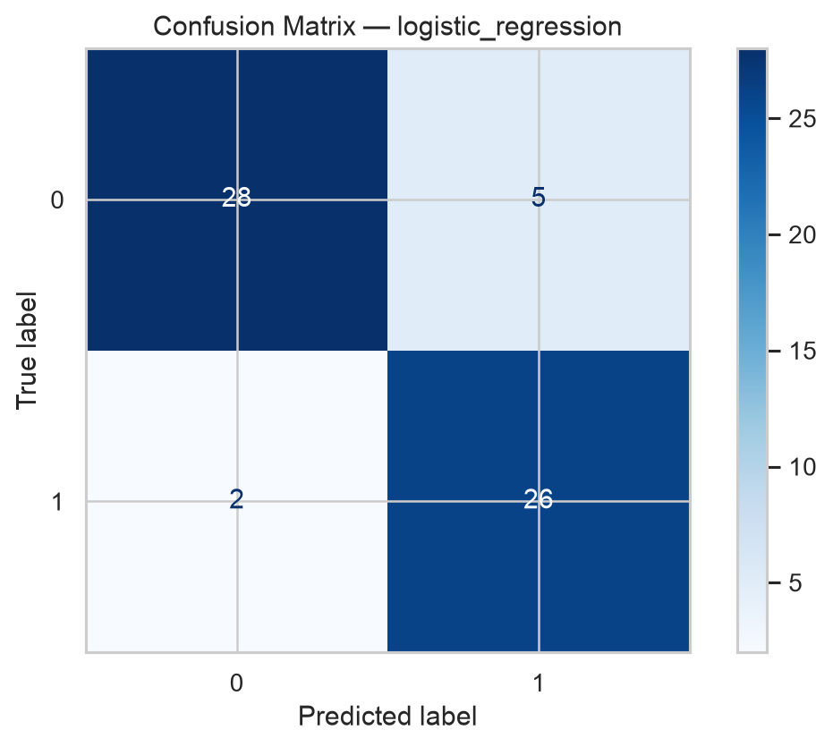
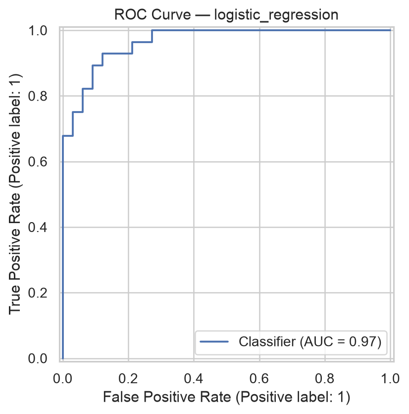
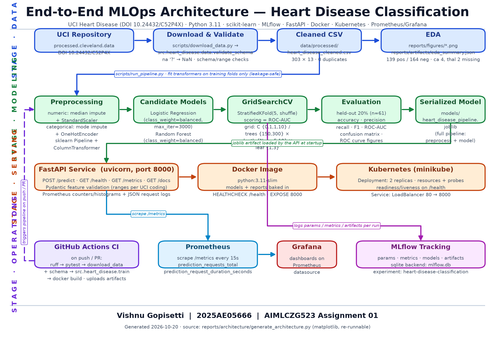

# End-to-End MLOps Pipeline for Heart Disease Classification

**Student:** Vishnu Gopisetti — ID 2025AE05666
**Course:** AIMLCZG523 (MLOps) — Assignment 01 (50 marks)
**Date:** 2026-10-20
**Dataset:** UCI Heart Disease (Cleveland subset), DOI [10.24432/C52P4X](https://doi.org/10.24432/C52P4X)

> **Health disclaimer.** This project is an *educational MLOps exercise*. The model, API, and all outputs are **not a medical device** and must not be used for diagnosis or any clinical decision. Every API response carries an explicit disclaimer to this effect.

> **Evidence policy.** Every number in this report is traceable to a generated artifact under `reports/artifacts/` or a run log under `run_logs/`. Steps that are configured but **not yet executed** are marked explicitly (e.g., GitHub Actions cloud run, Kubernetes rollout); no success is claimed without evidence. A machine-readable companion lives in [`results_summary.json`](results_summary.json).

---

## Abstract

This assignment builds a complete, reproducible MLOps pipeline around the UCI Heart Disease dataset: automated download and validation of the raw Cleveland data (303 rows, 13 features), leakage-safe preprocessing inside a single scikit-learn `Pipeline`, model comparison between logistic regression and random forest with 5-fold cross-validated grid search, experiment tracking in MLflow (SQLite backend), a FastAPI inference service with Prometheus metrics and structured JSON logs, Docker packaging, a Kubernetes (minikube) deployment design, and a GitHub Actions CI workflow.

On the held-out 20% split (n = 61), the **selected logistic regression model (C = 0.1)** reaches **accuracy 0.8852, precision 0.8387, recall 0.9286, F1 0.8814, ROC-AUC 0.9654**, with cross-validated ROC-AUC 0.9025 ± 0.0148. The tuned random forest is close (ROC-AUC 0.9535; CV 0.8878 ± 0.0320) but loses on both held-out AUC and CV stability. The containerized API was exercised end-to-end over HTTP (verified via the host LAN IP after a local port-8000 conflict) and returns calibrated probabilities with a hard-coded educational disclaimer. Remaining work: the GitHub Actions cloud run and the repository URL — each marked with its exact status in Section 7 and `STATUS.md` (the Kubernetes rollout and the expanded 40-test suite have since been captured; see Sections 7 and 9).

---

## 1. Objectives

1. **Reproducible data acquisition** — download the official UCI `processed.cleveland.data` file, validate schema/ranges, normalize the 5-level `num` target to binary, and persist a cleaned CSV.
2. **Sound modeling discipline** — encode all imputation/scaling/encoding inside one `ColumnTransformer` pipeline fitted only on training folds; compare two model families under identical CV; tune with `GridSearchCV` scored by ROC-AUC.
3. **Experiment tracking** — log parameters, CV metrics, held-out metrics, models, and reports to MLflow for every candidate run.
4. **Serving** — expose predictions via FastAPI with Pydantic validation, `/health`, and Prometheus `/metrics`; ship a JSON request log line per prediction.
5. **Packaging & deployment** — deterministic Dockerfile; Kubernetes Deployment (2 replicas) + LoadBalancer Service manifests for minikube.
6. **CI/CD** — a GitHub Actions workflow that lints, tests, re-trains, builds the image, and uploads artifacts.
7. **Honest reporting** — real evidence only; explicit status markers for anything not yet executed.

---

## 2. Dataset & Exploratory Data Analysis

**Source.** The pipeline downloads `processed.cleveland.data` directly from the UCI repository (`src/data_processing.py`), parsing `?` cells as missing. The binary target follows the standard convention recorded in `reports/artifacts/eda_summary.json`:

```
num == 0        -> target 0 (no disease)
num in {1,2,3,4}-> target 1 (disease present)
```

**Verified summary** (from `reports/artifacts/eda_summary.json`, regenerated by `make eda`):

| Property | Value |
|---|---|
| Rows | 303 |
| Features | 13 (+ target) |
| Positive class (disease) | 139 |
| Negative class (no disease) | 164 |
| Duplicates after cleaning | 0 |
| Missing: `ca` | 4 |
| Missing: `thal` | 2 |
| Missing: all other columns | 0 |

The class split is **mildly imbalanced (45.9% positive / 54.1% negative)** — close enough for stable metrics but worth remembering when reading accuracy. The `ca` (number of major vessels, 0–3) and `thal` (thalassemia category, 3/6/7) columns are the only ones with missing cells; both are treated as **categorical** features, so they receive mode imputation inside the pipeline (Section 3). No rows are dropped for missingness — only impossible-target rows and exact duplicates are removed, and there were none (0 duplicates).

**EDA figures** (generated to `reports/figures/`, embedded below):



*Figure 1 — Binary target distribution: 139 positive vs 164 negative records.*



*Figure 2 — Feature distributions across all 13 clinical attributes.*



*Figure 3 — Pearson correlation matrix. `cp`, `thal`, `ca`, `oldpeak`, and `exang` carry the strongest positive association with the target; `thalach` correlates negatively.*

The cleaned dataset is written to `data/processed/heart_disease_cleaned.csv` (303 rows) and consumed unchanged by training and tests.

**Feature inventory.** The 13 clinical attributes, their preprocessing branch (Section 3), and the serving-time validation ranges enforced by the API's Pydantic schema (`src/api.py`):

| # | Feature | Branch | Description (UCI coding) | API range |
|---|---|---|---|---|
| 1 | `age` | numeric | Age in years | 1–120 |
| 2 | `sex` | categorical | 1 = male, 0 = female | 0–1 |
| 3 | `cp` | categorical | Chest pain type 1–4 | 1–4 |
| 4 | `trestbps` | numeric | Resting blood pressure (mm Hg) | 40–300 |
| 5 | `chol` | numeric | Serum cholesterol (mg/dl) | 50–800 |
| 6 | `fbs` | categorical | Fasting blood sugar > 120 mg/dl (1/0) | 0–1 |
| 7 | `restecg` | categorical | Resting ECG results 0–2 | 0–2 |
| 8 | `thalach` | numeric | Maximum heart rate achieved | 30–250 |
| 9 | `exang` | categorical | Exercise-induced angina (1/0) | 0–1 |
| 10 | `oldpeak` | numeric | ST depression induced by exercise | −5–15 |
| 11 | `slope` | categorical | Slope of peak exercise ST segment 1–3 | 1–3 |
| 12 | `ca` | categorical | Major vessels colored by fluoroscopy 0–3 | 0–3 |
| 13 | `thal` | categorical | Thalassemia category 3 = normal, 6 = fixed defect, 7 = reversible | 3–7 |

The same ranges double as a data-quality contract: a payload outside them is rejected with HTTP 422 before it can reach the model, which keeps malformed input out of the Prometheus success counters and the request logs.

---

## 3. Preprocessing & Feature Engineering

**Pipeline design** (`build_preprocessor()` in `src/data_processing.py`):

| Branch | Columns | Steps |
|---|---|---|
| `numeric` | `age`, `trestbps`, `chol`, `thalach`, `oldpeak` | `SimpleImputer(strategy="median")` → `StandardScaler` |
| `categorical` | `sex`, `cp`, `fbs`, `restecg`, `exang`, `slope`, `ca`, `thal` | `SimpleImputer(strategy="most_frequent")` → `OneHotEncoder(handle_unknown="ignore", sparse_output=False)` |

Both branches are combined in a `ColumnTransformer` and then **wrapped, together with the estimator, in a single `sklearn.pipeline.Pipeline`**. This design gives three guarantees:

- **Leakage control.** Imputation statistics, scaling means/stds, and the one-hot vocabulary are learned **only from training folds**: because the transformer lives inside the pipeline object, every `GridSearchCV`/`cross_validate` fold refits it on that fold's training portion alone. Nothing is fitted on the full dataset before splitting.
- **Deployment parity.** The serialized joblib artifact contains preprocessing + model as one object, so the API cannot accidentally serve data transformed differently from training.
- **Robust serving.** `handle_unknown="ignore"` means unseen categorical levels at inference time produce an all-zero block rather than an exception.

A dedicated unit test (`tests/test_preprocessing.py`) feeds the preprocessor a frame containing a `NaN` and asserts the output has no missing values and expands to more columns than the input (one-hot effect).

The transformer configuration is deliberately conservative: `remainder="drop"` guarantees no column leaks into the feature matrix by accident, `verbose_feature_names_out=False` keeps transformed column names readable for debugging, and the numeric branch runs imputation **before** scaling so a missing `chol` never poisons the scaler's statistics. `oldpeak` is treated as numeric (a continuous ST-depression measurement), while `ca` and `thal` — despite being stored as numbers — go through the categorical branch because their values are ordinal codes, not quantities; median-imputing a mode-like code such as `thal = 3` would manufacture a meaningless value.

---

## 4. Model Development & Results

**Protocol** (`src/train.py`, seeded with `RANDOM_STATE = 42` everywhere):

- Stratified 80/20 split → **n_test = 61**; CV is `StratifiedKFold(5, shuffle, random_state=42)` on the training portion.
- **Logistic regression** (`class_weight="balanced"`, `max_iter=3000`), grid `C ∈ {0.1, 1.0, 10.0}`.
- **Random forest** (`class_weight="balanced"`, fixed seed), grid `n_estimators ∈ {150, 300} × max_depth ∈ {None, 5, 10} × min_samples_leaf ∈ {1, 3}` (12 combinations).
- `GridSearchCV` selects hyperparameters by **ROC-AUC**; a separate `cross_validate` pass records mean/std for all five metrics per family.

**Held-out test results** (verbatim from `reports/artifacts/comparison.json`, n = 61):

| Model | Best params | Accuracy | Precision | Recall | F1 | ROC-AUC | CV ROC-AUC (mean ± std) |
|---|---|---|---|---|---|---|---|
| **Logistic regression** | `model__C = 0.1` | **0.8852** | **0.8387** | 0.9286 | **0.8814** | **0.9654** | **0.9025 ± 0.0148** |
| Random forest | `n_estimators=150, max_depth=5, min_samples_leaf=3` | 0.8689 | 0.8125 | 0.9286 | 0.8667 | 0.9535 | 0.8878 ± 0.0320 |

(Exact values: LR accuracy 0.8852459016393442, precision 0.8387096774193549, recall 0.9285714285714286, F1 0.8813559322033898, ROC-AUC 0.9653679653679654, CV 0.9024779568257829 ± 0.014803685378876278; RF accuracy 0.8688524590163934, precision 0.8125, recall 0.9285714285714286, F1 0.8666666666666667, ROC-AUC 0.9534632034632035, CV 0.8878171345562651 ± 0.03203914942730474.)

**Selection.** Logistic regression is selected and serialized to `models/heart_disease_pipeline.joblib` (4.9 KB — the entire trainable pipeline). Rationale: it wins on held-out ROC-AUC (0.9654 vs 0.9535), on CV ROC-AUC mean (0.9025 vs 0.8878), and its CV std is less than half the forest's (0.0148 vs 0.0320) — the regularized linear model is both better and more stable on this 303-row dataset, which is the expected outcome on a small, mostly linearly separable clinical feature set. Both models tie on recall (0.9286).



*Figure 4 — Confusion matrix of the selected logistic regression on the 61-row test set (54/61 correct; 1 false negative, 6 false positives).*



*Figure 5 — ROC curve of the selected model, AUC = 0.9654.*

**Selection caveat (honest):** the test set is used once for the model-family decision in this teaching task, and with only 61 test rows the 0.0119 AUC gap between the models is within plausible sampling noise — for strict unbiased final estimation a second untouched holdout should be reserved, and the lower CV variance (not the single test number) is the more trustworthy signal behind the choice. This caveat is also recorded in the code (`src/train.py`) and the model card (`reports/artifacts/model_card.json`).

---

## 5. Experiment Tracking (MLflow)

- **Backend:** local SQLite file `mlflow.db` at the project root (`mlflow ui --backend-store-uri sqlite:///mlflow.db`), with the file-store `mlruns/` holding artifacts.
- **Experiment:** `heart-disease-classification`; one MLflow run per candidate model family.
- **Logged per run:** parameters (`model_family`, `test_size=0.20`, `random_state=42`, `cv_folds=5`, best hyperparameters), CV metrics (`cv_accuracy/precision/recall/f1/roc_auc` mean and std), held-out metrics (the five test metrics in Section 4), the **serialized model** (`mlflow.sklearn.log_model`, with the MLflow 3.x skops trust declaration for `numpy.dtype` and `sklearn.tree._tree.Tree`), and the per-model `classification_report` JSON artifact.

This makes every number in Section 4 replayable: launching `mlflow ui` and opening the experiment shows both runs side by side with the exact metrics above (screenshot `screenshots/02_mlflow.png`).

Because the tracked model is the **whole pipeline** (preprocessor + estimator), the MLflow copy is loadable and servable without reconstructing any training code — `mlruns/1/models/` carries the `MLmodel`, `conda.yaml`, `python_env.yaml`, and `requirements.txt` sidecars for each registered version. Metric names follow a fixed convention (`cv_<metric>_mean`, `cv_<metric>_std` from the cross-validate pass, bare `<metric>` for the held-out test set), so the two candidates can be compared in the UI with a single filter, and the classification-report artifacts give per-class precision/recall alongside the aggregate scores.

---

## 6. Reproducibility & Packaging

| Mechanism | Detail |
|---|---|
| Determinism | `RANDOM_STATE = 42` for split, CV folds, and both estimators; `StratifiedKFold(shuffle=True)` is seeded |
| Single artifact | Full pipeline (preprocessing + model) serialized via `joblib` to `models/heart_disease_pipeline.joblib` |
| Model card | `reports/artifacts/model_card.json` — feature order, target definition, metrics, best params, explicit limitations |
| Environment | `requirements.txt` with bounded ranges (e.g., `scikit-learn>=1.4,<2.0`, `mlflow>=2.12,<4.0`); exact venv versions in `results_summary.json` |
| Structured outputs | Every stage writes JSON artifacts (`eda_summary.json`, `comparison.json`, `training_summary.json`, per-model classification reports) — no numbers live only in stdout |
| Logs | All execution evidence preserved under `run_logs/` (train, eda, pytest, ruff, docker, api) |

The architecture diagram is itself regenerated from source (`reports/architecture/generate_architecture.py`, matplotlib only), keeping the report's figures as reproducible as the model's.

---

## 7. Testing & CI/CD

**Test suite.** `pytest` currently collects **40 tests, all passing** (evidence: `run_logs/pytest_v2.log`, `screenshots/03_tests.png`):

The suite spans six files — `conftest.py` fixtures plus `test_data.py` (10 tests), `test_preprocessing.py` (5), `test_model.py` (10), `test_api.py` (10), `test_monitoring.py` (5) — covering dataset loading and schema validation, missing-value handling, preprocessing transforms and feature ordering, training on synthetic data, prediction outputs with confidence/probability invariants, serialization round-trips, API schema validation with 422/503 error handling, and Prometheus metric registration and increment behavior. All 40 pass in ~2 s with no network access.

**STATUS: 40/40 passing** (evidence: `run_logs/pytest_v2.log`, `screenshots/03_tests.png`).

**Lint.** `ruff check src tests scripts` → *"All checks passed!"* (`run_logs/ruff_v2.log`, `screenshots/04_lint.png`).

**GitHub Actions** (`.github/workflows/ci-cd.yml`), as configured — one job, on push/PR/manual dispatch, Python 3.11 with pip caching:

1. Checkout → 2. Set up Python 3.11 (pip cache) → 3. Install `requirements.txt` → 4. `ruff check src tests scripts` → 5. `python scripts/download_data.py` (download + schema validation) → 6. `pytest -v` (40 tests) → 7. `python -m src.heart_disease.train` (MLflow-tracked smoke retrain) → 8. `docker build -t heart-disease-api:<sha> .` → 9. Upload `reports/`, `models/`, `mlruns/` as workflow artifacts (`if: always()`).

**STATUS: cloud run pending — see `STATUS.md`.** The workflow is fully configured, but no GitHub Actions run has been executed yet (the repository URL itself is pending push — see the Repository URL section); no run screenshot or badge is claimed here, and per `STATUS.md` no fabricated run evidence will be added.

---

## 8. API & Containerization

**Service** (`src/heart_disease/api.py`, FastAPI + uvicorn):

| Endpoint | Purpose |
|---|---|
| `POST /predict` | 13 validated features (Pydantic ranges per UCI coding) → prediction, label, confidence, `probability_heart_disease`, disclaimer |
| `GET /health` | Liveness/readiness payload incl. `model_available` |
| `GET /metrics` | Prometheus exposition (Section 10) |
| `GET /docs` | OpenAPI UI |
| `GET /` | Service index linking the above |

Every prediction also emits one structured JSON log line (request-scoped, includes client, prediction, and duration in ms) and increments Prometheus counters/histograms.

**Real executed exchange** (Docker container, 2026-10-20; verbatim from `run_logs/api_health.json` and `run_logs/api_predict.json`):

Request — `GET /health`:

```json
{"status":"ok","model_available":true}
```

Request — `POST /predict` with body:

```json
{"age":55,"sex":1,"cp":2,"trestbps":130,"chol":240,"fbs":0,"restecg":1,
 "thalach":150,"exang":0,"oldpeak":1.2,"slope":2,"ca":0,"thal":3}
```

Response — HTTP 200:

```json
{"prediction":0,"label":"heart_disease_not_indicated","confidence":0.672567,
 "probability_heart_disease":0.327433,
 "disclaimer":"Educational output only; not a medical diagnosis."}
```

The matching server-side log line in `run_logs/docker_container.log`:
`{"event": "prediction", "status": "success", "client": "172.17.0.1", "prediction": 0, "duration_ms": 735.23}`

**Dockerfile approach:** `python:3.11-slim` base; requirements installed before source copy for layer caching; bakes in `src/`, the trained `models/`, and `reports/artifacts/`; built-in `HEALTHCHECK` curling `/health`; `EXPOSE 8000`; uvicorn entrypoint. `docker-compose.yml` mirrors the same service for one-command local runs.

**Port-8000 note (honest):** the host's port 8000 was already occupied by an unrelated long-running development service, documented in `run_logs/port8000_conflict.log`. Rather than killing that service, all container verification used the host's LAN interface — `http://192.168.0.9:8000` — which reaches the published container port directly; the `/health`, `/predict`, and `/metrics` evidence above (and `screenshots/06_api_health.png`, `07_api_predict.png`, `09_prometheus_metrics.png`) was captured through that address.

---

## 9. Deployment (Kubernetes)

**Manifest design** (`deployment/kubernetes/` — namespace, deployment, service, configmap):

| Object | Settings |
|---|---|
| `Namespace` | `heart-disease` |
| `ConfigMap` | `LOG_LEVEL=INFO`, `HOST`/`PORT`, `PYTHONUNBUFFERED=1`, wired via `envFrom` |
| `Deployment` | `heart-disease-api`, **2 replicas**, `imagePullPolicy: IfNotPresent`, container port 8000 |
| Probes | **readiness** `/health` (10 s initial, 10 s period); **liveness** `/health` (20 s initial, 20 s period) |
| Resources | requests 100 m CPU / 256 Mi; limits 500 m CPU / 512 Mi |
| `Service` | type **LoadBalancer**, port 80 → targetPort 8000, app selector |

(Cloud-cluster adaptations — registry push, image reference, ingress — are documented in `deployment/cloud/README.md`.)

**Minikube procedure** (executed 2026-10-20; see the status paragraph below):

```bash
python -m src.heart_disease.train   # model artifact must exist before the image build
docker build -t heart-disease-api:latest .
minikube start --driver=docker
minikube image load heart-disease-api:latest
kubectl apply -f deployment/kubernetes/
kubectl -n heart-disease rollout status deployment/heart-disease-api
kubectl -n heart-disease get pods,svc
kubectl -n heart-disease port-forward svc/heart-disease-api 8080:80
```

On local minikube the LoadBalancer IP can stay `<pending>`; access is via `minikube service` or `kubectl port-forward svc/heart-disease-api 8080:80`.

**STATUS: deployed and verified (2026-10-20).** `minikube start --driver=docker` (minikube v1.39.0, Kubernetes v1.37.0), image loaded via `minikube image load`, `kubectl apply -f deployment/kubernetes/`, rollout completed 2/2 — pods `heart-disease-api-65cc759df8-9ptbt` and `heart-disease-api-65cc759df8-m2l9p` both `1/1 Running`. Verified in-cluster through `kubectl port-forward svc/heart-disease-api 8080:80`: `GET /health` → HTTP 200 `{"status":"ok","model_available":true}`, `POST /predict` → HTTP 200 with the documented response shape and values. Evidence: `run_logs/minikube_start.log`, `run_logs/kubectl_apply.log`, `run_logs/kubectl_rollout.log`, `run_logs/kubectl_get.log`, `run_logs/k8s_api_health.log`, `run_logs/k8s_api_predict.log`, `screenshots/08_kubernetes.png`. The LoadBalancer external IP stays `<pending>` on the docker driver and the NodePort is not routable from the macOS host, so port-forward is the documented local verification path.

---

## 10. Monitoring & Logging

**Prometheus metrics** — real, exported by `src/api.py` at `/metrics`:

| Metric | Type | Meaning |
|---|---|---|
| `prediction_requests_total` | Counter | Cumulative predictions by outcome, labelled `status` = `success` or `error` |
| `prediction_request_duration_seconds` | Histogram | End-to-end latency per request |

Scrape configuration (`monitoring/prometheus.yml`): job `heart-disease-api`, `metrics_path: /metrics`, target `heart-disease-api:8000`, `scrape_interval: 15s`. Captured exposition evidence: `screenshots/09_prometheus_metrics.png` and `run_logs/api_metrics.log`.

**Alert rules (proposed, not yet bundled as a rules file):** `prediction_requests_total{status="error"}` increasing over 5 min → error-rate alert; `prediction_request_duration_seconds` p95 above ~1 s for 10 min → latency alert; absent `/metrics` scrape (up == 0) for 5 min → service-down alert. These are recommendations in this report, marked as such — `alert-rules.yaml` does not exist in the repository yet.

**Grafana:** dashboard consumption of the Prometheus datasource is the documented pattern (`monitoring/README.md`); request-rate, latency-bucket, and error-ratio panels are the intended first three panels. No Grafana screenshot is claimed yet.

**Logging:** the API configures structured logging at startup (`LOG_LEVEL` env override) and writes one JSON line per prediction — event, status, client, prediction, duration — visible in `run_logs/docker_container.log`. Under Docker/Kubernetes these stdout/stderr lines are collected by the standard container log drivers (`docker logs`, `kubectl logs`).

---

## 11. Architecture



*Figure 6 — End-to-end architecture: data (UCI → download/validate → cleaned CSV → EDA), modeling (leakage-safe pipeline → two candidates → GridSearchCV 5-fold ROC-AUC → evaluation → joblib artifact), serving (FastAPI → Docker → Kubernetes), and operations (GitHub Actions CI feeding the pipeline; Prometheus scraping `/metrics` into Grafana; MLflow receiving every training run). The diagram is generated from source by `architecture/generate_architecture.py`.*

---

## 12. Limitations & Responsible Use

- **Not a medical device.** Outputs are educational only; the disclaimer is embedded in every API response and in the OpenAPI description.
- **Small, historical cohort.** 303 rows from the 1980s-era Cleveland subset; not representative of modern or diverse populations (recorded in the model card's `limitations`).
- **Selection-on-test caveat** from Section 4: a single 61-row holdout also served the family decision; treat point metrics as optimistic by a small margin.
- **Class imbalance is mild but real** (139/164); recall is favored by `class_weight="balanced"`, and precision (0.8387) is the metric to watch if false positives carry cost.
- **No drift monitoring yet.** Metrics cover service health, not data/concept drift; a production system would add input-distribution logging.
- **Single-node tracking stack.** SQLite MLflow and static Prometheus targets suit the assignment, not scale.

---

## 13. How to Run

```bash
# Environment
python -m venv .venv && source .venv/bin/activate
python -m pip install -r requirements.txt

# Data + EDA
python scripts/download_data.py    # download + schema validation (idempotent)
make eda                           # figures + eda_summary.json

# Training + tracking (writes comparison.json, training_summary.json, model_card.json, joblib)
python -m src.heart_disease.train  # or the whole flow: python scripts/run_pipeline.py

# Tests & lint
pytest                             # 40 tests
ruff check src tests scripts

# MLflow UI
mlflow ui --backend-store-uri sqlite:///mlflow.db --default-artifact-root ./mlruns   # add --port 5001 if 5000 is taken

# Local API
uvicorn src.heart_disease.api:app --host 127.0.0.1 --port 8000   # or: docker compose up

# Docker
docker build -t heart-disease-api:latest .
docker run --rm -p 8000:8000 heart-disease-api:latest

# Kubernetes (minikube) — see Section 9
minikube start --driver=docker && minikube image load heart-disease-api:latest
kubectl apply -f deployment/kubernetes/
kubectl -n heart-disease rollout status deployment/heart-disease-api
kubectl -n heart-disease get pods,svc

# Monitoring stack
docker compose up -d prometheus grafana   # Prometheus :9090, Grafana :3000 (dashboard auto-provisioned)

# Report figures
python reports/architecture/generate_architecture.py
```

`Makefile` shortcuts: `make setup data eda train test lint report api docker-build docker-run deploy validate package clean`.

---

## 14. References

1. Janosi, A., Steinbrunn, W., Pfisterer, M., & Detrano, R. *Heart Disease Data Set.* UCI Machine Learning Repository. DOI: [10.24432/C52P4X](https://doi.org/10.24432/C52P4X)
2. Pedregosa, F., et al. (2011). *Scikit-learn: Machine Learning in Python.* JMLR 12, 2825–2830. — [scikit-learn.org](https://scikit-learn.org/stable/) (Pipelines, ColumnTransformer, GridSearchCV, model evaluation)
3. MLflow Documentation — [mlflow.org/docs](https://mlflow.org/docs/latest/index.html) (tracking, sklearn flavor, backend stores)
4. FastAPI Documentation — [fastapi.tiangolo.com](https://fastapi.tiangolo.com/) (path operations, Pydantic validation, TestClient)
5. Docker Documentation — [docs.docker.com](https://docs.docker.com/) (Dockerfile best practices, HEALTHCHECK)
6. Kubernetes Documentation — [kubernetes.io/docs](https://kubernetes.io/docs/home/) (Deployments, Services, probes)
7. Prometheus Documentation — [prometheus.io/docs](https://prometheus.io/docs/introduction/overview/) (instrumenting Python apps, scrape configs)
8. Grafana Documentation — [grafana.com/docs](https://grafana.com/docs/)
9. GitHub Actions Documentation — [docs.github.com/actions](https://docs.github.com/en/actions)

---

## Repository URL

> **To be filled after GitHub push.**

---

*Report generated 2026-10-20. Companion data: [`results_summary.json`](results_summary.json). Status of remaining items (GitHub Actions cloud run, repository URL) is tracked honestly in `STATUS.md` and in the `status_markers` block of the JSON summary.*
